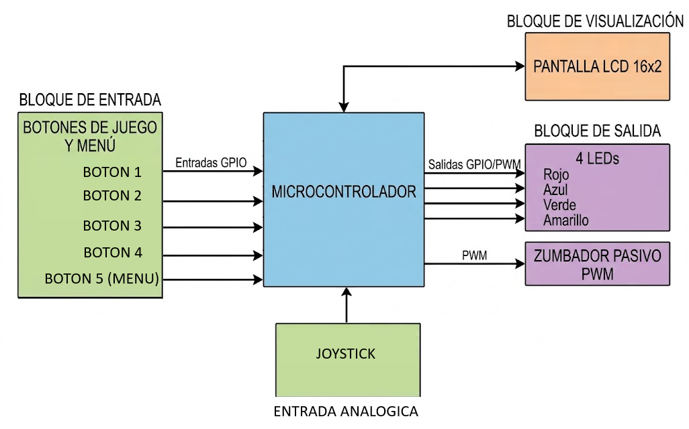

# Juego Interactivo "Simón Dice"

**Autores:** Tomás Antonio Lotierzo, Joaquín Alvarez, José Valls  
**Padrones:** 113495, 112327, 108024  
**Fecha:** 2do Cuatrimestre 2026  

---

## 1. Selección del proyecto a implementar

### 1.1. Objetivo del proyecto

Este proyecto pretende diseñar, desarrollar e implementar una versión del clásico juego de memoria "Simón Dice" como un sistema embebido. Como objetivo principal, el sistema deberá gestionar de manera concurrente la generación aleatoria de secuencias lumínicas y sonoras, la lectura de entradas de usuario (pulsadores), la realimentación audiovisual y la gestión de puntajes y niveles de dificultad progresivos.

**Objetivos secundarios:**
* Agregar EEPROM para usarla como memoria externa que almacene datos del usuario (como un historial de puntajes por partida y un puntaje récord).

---

### 1.2. Opciones de arquitectura de hardware (3 Casos)

A continuación, planteamos 3 casos diferentes para realizar el proyecto:

* **Caso Básico:**
  * **Microcontrolador:** STM32 NUCLEO-F103RB.
  * **Interfaz de Usuario:** 4 pulsadores táctiles estándar y 4 LEDs comunes con sus respectivas resistencias de limitación.
  * **Visualización:** Sin pantalla dedicada ni sistema de registro de puntos.

* **Caso Intermedio:**
  * **Microcontrolador:** STM32 NUCLEO-F103RB.
  * **Interfaz de Usuario:** 4 pulsadores táctiles estándar y 4 LEDs comunes con sus respectivas resistencias de limitación.
  * **Audio:** Buzzer pasivo controlado por PWM para reproducir melodías o tonos con mayor fidelidad (cada pulsador reproduce su propio tono).
  * **Visualización:** Sin pantalla dedicada; el puntaje y el estado del juego se indican mediante patrones de parpadeo de los LEDs.

* **Caso Avanzado:**
  * **Microcontrolador:** STM32 NUCLEO-F103RB.
  * **Interfaz de Usuario:** 4 pulsadores táctiles estándar y 4 LEDs comunes (de diferentes colores) con sus respectivas resistencias de limitación. Sensor analógico joystick (y otro  pulsador) para la navegación fluida por la interfaz y menú de selección de dificultad. La dificultad de la partida puede ser en modo fácil o difícil.
  * **Audio:** Buzzer pasivo controlado por PWM para reproducir melodías o tonos con mayor fidelidad (cada pulsador reproduce su propio tono).
  * **Visualización:** Pantalla LCD 16x2 gráfica interactiva y menú de selección de dificultad.

---

### 1.3. Matriz comparativa de casos

Escogimos 5 características que consideramos importantes evaluar para este proyecto:
1. **Disponibilidad de componentes:** La facilidad de acceso y obtención de los componentes en el mercado (peso: 10).
2. **Costo:** El costo económico estimado en base a los componentes de hardware (peso: 6).
3. **Experiencia de usuario:** Evalúa la calidad esperada del juego desde la vista del usuario (peso: 7).
4. **Complejidad de software:** La dificultad de poder implementar los componentes de hardware (peso: 5).
5. **Complejidad de hardware:** La dificultad de poder implementar el código necesario de la parte de software (peso: 8).

<table>
  <thead>
    <tr>
      <th rowspan="2">Casos</th>
      <th colspan="2">Básico</th>
      <th colspan="2">Intermedio</th>
      <th colspan="2">Avanzado</th>
    </tr>
    <tr>
      <th>Puntaje</th>
      <th>Puntaje Ponderado</th>
      <th>Puntaje</th>
      <th>Puntaje Ponderado</th>
      <th>Puntaje</th>
      <th>Puntaje Ponderado</th>
    </tr>
  </thead>
  <tbody>
    <tr>
      <td>Disponibilidad de componentes <i>(peso : 10)</i></td>
      <td align="center">10</td>
      <td align="center">100</td>
      <td align="center">9</td>
      <td align="center">90</td>
      <td align="center">7</td>
      <td align="center">70</td>
    </tr>
    <tr>
      <td>Costo <i>(peso : 6)</i></td>
      <td align="center">8</td>
      <td align="center">48</td>
      <td align="center">7</td>
      <td align="center">42</td>
      <td align="center">5</td>
      <td align="center">30</td>
    </tr>
    <tr>
      <td>Experiencia de usuario <i>(peso : 7)</i></td>
      <td align="center">5</td>
      <td align="center">35</td>
      <td align="center">7</td>
      <td align="center">49</td>
      <td align="center">10</td>
      <td align="center">70</td>
    </tr>
    <tr>
      <td>Complejidad de software <i>(peso : 5)</i></td>
      <td align="center">9</td>
      <td align="center">45</td>
      <td align="center">8</td>
      <td align="center">40</td>
      <td align="center">4</td>
      <td align="center">20</td>
    </tr>
    <tr>
      <td>Complejidad de hardware <i>(peso : 8)</i></td>
      <td align="center">10</td>
      <td align="center">80</td>
      <td align="center">7</td>
      <td align="center">56</td>
      <td align="center">4</td>
      <td align="center">32</td>
    </tr>
    <tr>
      <td><b>Puntaje Total</b></td>
      <td align="center">-</td>
      <td align="center"><b>308</b></td>
      <td align="center">-</td>
      <td align="center"><b>277</b></td>
      <td align="center">-</td>
      <td align="center"><b>222</b></td>
    </tr>
  </tbody>
</table>

<em>Tabla 1: Tabla comparativa de los 3 casos</em>

---

### 1.4. Elección de la arquitectura a implementar

A pesar de que en la matriz ponderada el Caso Básico obtuvo una puntuación más elevada debido a su menor costo y simplicidad de implementación, elegimos implementar el **Caso Avanzado** por la excelente experiencia que brinda al usuario gracias a una interfaz interactiva estilo "arcade" y una pantalla LCD para que el usuario se pueda manejar mejor con una interfaz visual. Además, exige una gestión de software más completa y profesional.

A diferencia del ejemplo de referencia del "Simón Dice" que se brinda en las consignas del trabajo, decidimos agregar un sensor analógico de joystick en vez de un sensor de luz LDR que ajuste el brillo de los LEDs, y un pulsador extra que ayude en la navegación de la interfaz del usuario.

---

### 1.5. Diagrama en bloques del sistema

A continuación, presentamos el diagrama en bloques del sistema:

  
   
  <em>Figura 1: Diagrama en bloques del sistema</em>

---

## 2. Elicitación de requisitos y casos de uso

Los casos de uso de este proyecto se da en el mercado de juguetes electrónicos, encontramos principalmente dos referentes que adaptan el clásico juego de memoria "Simón Dice".

Como primer competidor tenemos a Hasbro con su versión clásica y masiva de "Simón", un dispositivo comercial con botones luminosos grandes y sonidos sintetizados fijos para cada botón, orientado al público infantil y sin opciones de configuración avanzada ni pantallas.

Por otro lado, existen kits didácticos comercializados por tiendas de robótica, los cuales ofrecen placas de desarrollo tipo Arduino junto a matrices de botones y LEDs pensados para talleres escolares y técnicos, destacándose por su código abierto pero sin interfaz de usuario pulida ni menús de dificultad interactivos.

En conclusión, el desarrollo de este proyecto en Argentina representa una solución innovadora y de alto valor académico, ya que logra fusionar la nostalgia y accesibilidad del entretenimiento clásico con un diseño embebido robusto basado en microcontroladores STM32. Al incorporar una pantalla LCD y controles de navegación analógicos pretendemos diseñar hardware interactivo de manera diferente, optimizando los recursos disponibles en el mercado local.

---

### 2.1. Requisitos del proyecto

| Grupo | ID | Descripción |
| :--- | :--- | :--- |
| **Lógica del Juego** | 1.1 | El microcontrolador generará una secuencia de colores aleatoria mediante un algoritmo pseudoaleatorio. |
| | 1.2 | El usuario ingresará la secuencia memorizada mediante cuatro pulsadores de juego asignados a cada LED. |
| | 1.3 | El sistema evaluará en tiempo real cada pulsación del usuario comparándola contra el patrón objetivo guardado. |
| | 1.4 | Si lo que ingresó el usuario es correcto, el sistema aumentará el nivel y agregará un paso más al patrón. |
| | 1.5 | Ante un fallo de ingreso, el sistema detendrá la partida, indicará el error y mostrará las estadísticas finales. |
| | 1.6 | En modo fácil, al inicio de cada ronda se reproducirá el patrón completo acumulado hasta el momento. |
| | 1.7 | En modo Difícil, al inicio de cada ronda se reproducirá con mayor rapidez el patrón completo acumulado hasta el momento. |
| **Interfaz Audiovisual Base** | 2.1 | Cada uno de los 4 LEDs de juego estará vinculado a un color distinto y un tono específico de audio. |
| | 2.2 | Durante la emisión automática de la secuencia, los LEDs correspondientes se iluminarán con un temporizador. |
| | 2.3 | La activación de cualquier pulsador iluminará su LED asociado de forma continua durante el tiempo de presión. |
| | 2.4 | Se filtrarán los rebotes mecánicos de todos los pulsadores usando el debounce por software. |
| | 2.5 | Se gestionará la lectura de entradas con suficiente frecuencia para no perder pulsaciones rápidas del usuario. |
| **Control Analógico** | 3.1 | Se incluirá un joystick analógico conectado a los canales del ADC del STM32. |
| | 3.2 | Sólo se usarán movimientos horizontales del joystick analógico para la navegación del menú. |
| **Pantalla LCD** | 4.1 | Una pantalla LCD de 16x2 exhibirá el estado general de la partida, configuraciones y puntajes. |
| | 4.2 | Al inicializar el equipo, la pantalla presentará un mensaje inicial de bienvenida. |
| | 4.3 | La pantalla mostrará el menú principal para seleccionar el nivel de dificultad y consultar marcas previas. |
| | 4.4 | Durante el transcurso del juego, el LCD indicará en tiempo real el nivel actual. |
| **Menú de Interacción** | 5.1 | La navegación por el menú interactivo se realizará mediante el joystick analógico y pulsadores dedicados de selección. |
| | 5.2 | Se dispondrá de un botón extra para confirmar la selección entre opciones. |
| | 5.3 | El LCD actualizará el cursor y resaltará la opción activa seleccionada por el usuario antes de confirmar. |
| | 5.4 | Al perder el juego se volverá al menú interactivo. |
| **Sistema de Audio** | 6.1 | Un zumbador (buzzer pasivo) accionado por PWM generará las frecuencias sonoras. |
| | 6.2 | Cada botón o color emitirá un tono diferente. |
| | 6.3 | Al cometer un error en la secuencia, el buzzer emitirá un tono grave característico. |
| | 6.4 | La interacción con los elementos del menú principal emitirá tonos cortos de confirmación o movimiento. |
| **Configuración de Dificultad** | 7.1 | Habrán dos configuraciones de partida: Fácil (patrones lentos) y Difícil (patrones rápidos). |
| **Persistencia en Memoria (EEPROM)** | 8.1 | Se guardará el puntaje récord en la EEPROM para evitar su pérdida al apagar el equipo. |
| | 8.2 | Los últimos puntajes se guardarán también en la memoria EEPROM. |
| | 8.3 | Se podrán consultar los puntajes en el menú (no se podrá durante una partida). |
| | 8.4 | Se integrará una opción en el menú que permita resetear los datos del récord guardados. |
| **Robustez y Seguridad del Firmware** | 9.1 | El sistema iniciará manteniendo actuadores, LEDs y audio inactivos hasta iniciar la partida. |
| | 9.2 | Ante fallas de lectura o estados no válidos, el sistema mostrará un aviso de advertencia en pantalla sin bloquearse. |

<em>Tabla 2: Requisitos del proyecto</em>

---

### 2.2. Caso de Uso 1: Inicio de partida

| Elemento | Definición |
| :--- | :--- |
| **Disparador** | El jugador desea configurar los parámetros iniciales (dificultad) e iniciar una nueva partida del juego desde el menú principal. |
| **Precondiciones** | El sistema se encuentra alimentado, la rutina de inicialización finalizó correctamente, se mostró la pantalla de bienvenida y el menú principal está desplegado en la pantalla LCD 16x2. Todos los LEDs y el buzzer permanecen inactivos. |
| **Flujo principal** | El jugador mueve el joystick analógico horizontalmente para desplazarse entre las opciones del menú ("Modo Fácil", "Modo Difícil", "Ver Récord"). El LCD actualiza la posición del cursor de navegación en tiempo real. El jugador presiona el pulsador de selección del menú para confirmar la dificultad elegida. El sistema emite un tono corto de confirmación en el buzzer pasivo. El sistema inicializa las variables de puntaje, genera la semilla aleatoria y muestra en la pantalla LCD el mensaje de inicio junto al nivel 1. El juego pasa al estado activo de emisión de secuencia. |
| **Flujos alternativos** | **a) Inactividad en el menú:** Si no se detecta movimiento en el joystick ni pulsaciones durante 30 segundos, el sistema entra en un modo de espera (pantalla de reposo) atenuando el brillo del LCD hasta nueva interacción. |

<em>Tabla 3: Caso de uso 1: Inicio de partida</em>

---

### 2.3. Caso de Uso 2: Ejecución de ronda y validación de secuencia

| Elemento | Definición |
| :--- | :--- |
| **Disparador** | Inicia un nuevo nivel/ronda dentro de una partida activa. |
| **Precondiciones** | Existe una partida activa iniciada. El sistema conoce la dificultad seleccionada (Fácil o Difícil) y la secuencia acumulada de niveles anteriores. |
| **Flujo principal** | El microcontrolador añade un nuevo paso/color aleatorio a la secuencia objetivo. El sistema reproduce la secuencia en los LEDs y el buzzer: en Modo Fácil emite la secuencia completa acumulada a una velocidad lenta; en Modo Difícil emite la secuencia completa a velocidad rápida. El jugador repite la secuencia presionando los 4 pulsadores de juego. Por cada pulsación, se aplica el filtro de debouncing, se ilumina el LED correspondiente y se emite su frecuencia de audio en el buzzer. El sistema compara cada paso ingresado con el patrón objetivo. Al completar correctamente el patrón, se incrementa el nivel y se actualiza el LCD. |
| **Flujos alternativos** | **a) El jugador presiona un botón equivocado:** El sistema detecta el desacoplamiento, detiene inmediatamente la lectura de pulsadores y deriva al caso de cierre por error (Game Over). **b) El jugador excede el tiempo límite de respuesta (Timeout):** Si transcurre el tiempo máximo configurado sin recibir pulsación, la ronda se da por perdida automáticamente. |

<em>Tabla 4: Caso de uso 2: Ejecución de ronda y validación de secuencia</em>

---

### 2.4. Caso de Uso 3: Cierre de partida y registro de récord

| Elemento | Definición |
| :--- | :--- |
| **Disparador** | El jugador comete un error en la secuencia de ingreso o se agota el tiempo límite de respuesta durante una ronda activa. |
| **Precondiciones** | La partida estaba en ejecución y se produjo una condición de fallo o tiempo agotado. |
| **Flujo principal** | El sistema detiene la ronda y activa una señal de error (destello simultáneo de los 4 LEDs y tono grave característico en el buzzer pasivo por PWM). La pantalla LCD cambia a la interfaz de "Game Over", mostrando la puntuación final (hasta qué nivel llegó) obtenida por el jugador. El microcontrolador lee la memoria EEPROM externa para comparar el puntaje de la partida con el récord histórico registrado. Si el puntaje actual supera al récord guardado, el sistema escribe la nueva marca en la EEPROM y se muestra el mensaje "¡NUEVO RÉCORD!" en la pantalla LCD. Tras transcurrir 5 segundos, el sistema regresa automáticamente al menú principal. |
| **Flujos alternativos** | **a) El puntaje obtenido no supera el récord previo:** La pantalla LCD simplemente muestra la marca obtenida y el récord histórico vigente sin realizar escrituras en la memoria EEPROM. **b) Reinicio manual durante el "Game Over":** Si el jugador presiona el pulsador de selección antes de los 5 segundos, el sistema salta la espera y regresa de inmediato al menú principal. |

<em>Tabla 5: Caso de uso 3: Cierre de partida y registro de récord</em>

